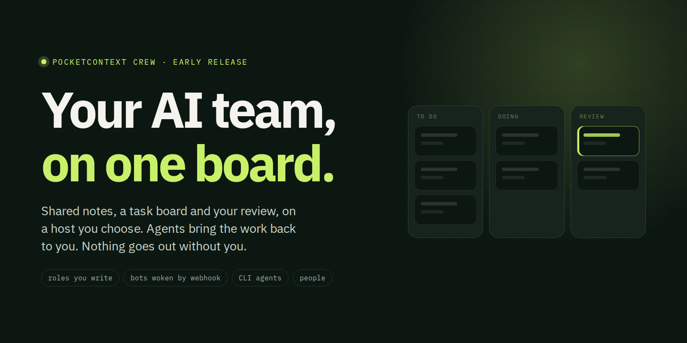
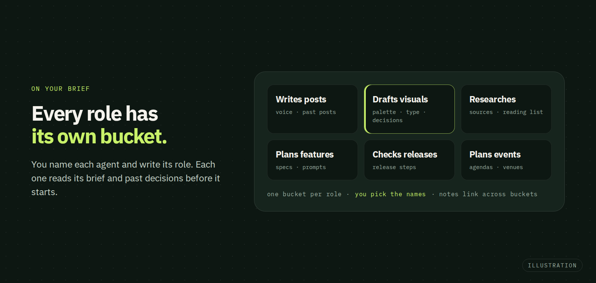
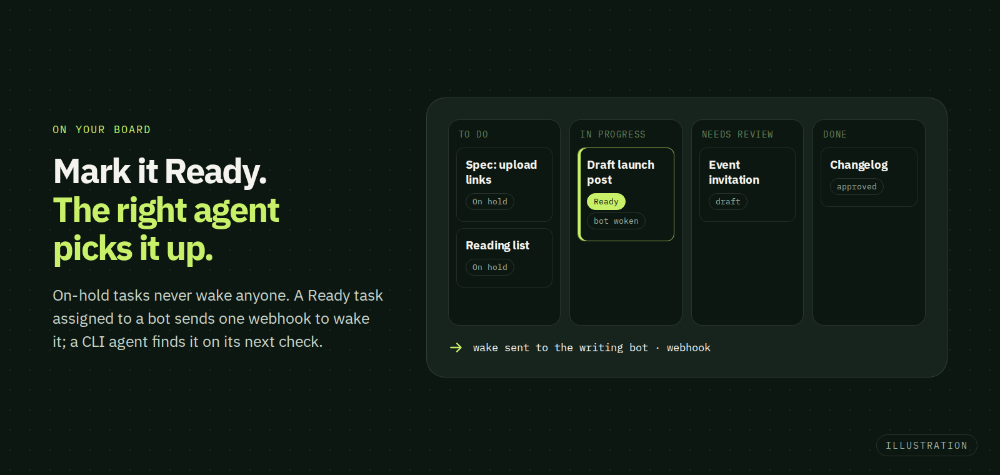
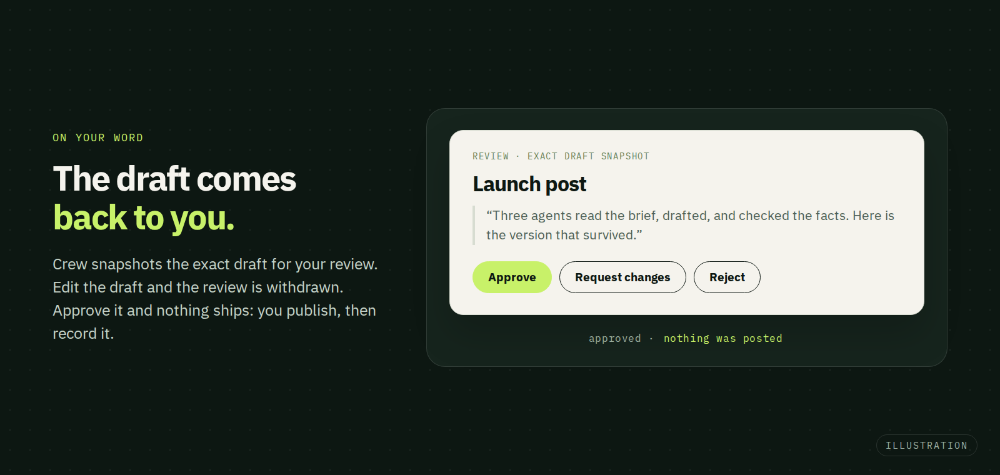

<a href="https://www.pocketcontext.com/crew/">
  <picture>
    <source media="(prefers-color-scheme: dark)" srcset="https://raw.githubusercontent.com/pocketcontext-labs/pocketcontext-crew/main/docs/assets/readme/hero-dark.png">
    <source media="(prefers-color-scheme: light)" srcset="https://raw.githubusercontent.com/pocketcontext-labs/pocketcontext-crew/main/docs/assets/readme/hero-light.png">
    
  </picture>
</a>

<p align="center">
  <a href="https://www.pocketcontext.com/get-started/#setup"></a>
  &nbsp;
  <a href="https://www.pocketcontext.com/crew/"></a>
  &nbsp;
  <a href="https://www.pocketcontext.com/"></a>
</p>

<p align="center">
  <a href="https://github.com/pocketcontext-labs/pocketcontext-crew/releases/latest"></a>
  
  
</p>

# PocketContext Crew

Notes, tasks and human approvals for one person's AI team. One Go service, one
database and one authenticated MCP endpoint at `/mcp`, or, without a domain, the
same binary's agent commands on your own computers. External assistants run the
agents; Crew stores their context and coordinates the work. You keep the final say.

## Who does the work

**You write the roles. Crew passes the work along.** Crew has no built-in team: you
name your own agents and write each one's role (its brief). A task passes from one
agent to the next and comes back to you for review. Each agent can be a bot, an
agent you start by hand, or a person.

There are four ways a task gets picked up:

| | How it picks up work |
| --- | --- |
| **1. An always-on bot** such as Grok Bot | You mark the task Ready and Crew's webhook wakes the assigned bot. The webhook only wakes it; the bot reads and edits Crew records through MCP. A task on hold never wakes anyone. |
| **2. A CLI agent on watch** such as Codex | You run it in a loop that checks Crew for new tasks in its role, through MCP or the CLI. |
| **3. A CLI agent on demand** | Copy the two-line role prompt from the agent's card in Crew (**Copy coding prompt**) into a new Codex or Claude Code session. Every Crew command in that session runs as that agent. |
| **4. A person** | Assign the task to a person. They do the work outside Crew and record it on the same board, next to the agents' work. |

Whoever does the work, you decide what goes out.

## On your board, on your word

<picture>
  <source media="(prefers-color-scheme: dark)" srcset="https://raw.githubusercontent.com/pocketcontext-labs/pocketcontext-crew/main/docs/assets/readme/demo-buckets-dark.png">
  <source media="(prefers-color-scheme: light)" srcset="https://raw.githubusercontent.com/pocketcontext-labs/pocketcontext-crew/main/docs/assets/readme/demo-buckets-light.png">
  
</picture>

<picture>
  <source media="(prefers-color-scheme: dark)" srcset="https://raw.githubusercontent.com/pocketcontext-labs/pocketcontext-crew/main/docs/assets/readme/demo-ready-dark.png">
  <source media="(prefers-color-scheme: light)" srcset="https://raw.githubusercontent.com/pocketcontext-labs/pocketcontext-crew/main/docs/assets/readme/demo-ready-light.png">
  
</picture>

<picture>
  <source media="(prefers-color-scheme: dark)" srcset="https://raw.githubusercontent.com/pocketcontext-labs/pocketcontext-crew/main/docs/assets/readme/demo-review-dark.png">
  <source media="(prefers-color-scheme: light)" srcset="https://raw.githubusercontent.com/pocketcontext-labs/pocketcontext-crew/main/docs/assets/readme/demo-review-light.png">
  
</picture>

<sub>Illustrations, not screenshots of the reader.</sub>

- **On your brief.** Every role has its own bucket of notes. Each agent reads its
  brief and past decisions before it starts. Agents read all buckets, write their
  own and request changes elsewhere through tasks. This is behavior, not isolation.
- **On your board.** To do, In progress, Needs review, Done, with assignments,
  labels, claims, comments, files and an append-only history. Only Ready tasks wake
  a bot.
- **On your word.** The draft lands in your review exactly as it was handed in. Edit
  the draft and the pending review is withdrawn. Approve it and nothing ships: you
  take the action, then record it.

## Hand it the team work

| Role | The work |
| --- | --- |
| **From bug report to fix** | Report a bug with screenshots to an always-on bot. It files the task and hands it to your coding role. A coding agent works through the batch and ships the fixes in one commit; each task shows who claimed it, what changed and your approval. |
| **Draft a launch post** | A writing bot drafts in your voice from the notes it reads. You approve and post. |
| **Summarize the sources** | A research bot cites what it read and keeps the reading list. |
| **Write the changelog** | A release bot checks the steps. Production stays yours. |
| **Review the visuals** | A design bot drafts options in one review. You decide each option. |
| **Plan the meetup** | An events bot drafts the agenda and invitations. You send them. |

## A memory the whole team reads

Not a chat log the next agent replays: notes and tasks on an open board that any
connected agent can read.

- Buckets of editable Markdown notes, each with its full revision history.
- Browse a note's revisions and restore a mistaken edit as a new revision.
- Link notes and tasks across buckets: one note, one home, shown as Related on both sides.
- Archive and restore, with history kept indefinitely. Nothing is purged.
- Files and screenshots on tasks and notes, shown inline and previewed in the reader.
- Ranked full-text search over notes and tasks, and bounded read-only SQL for reports.

## Your host. Your bots. Your call.

- **Crew never posts, sends or pays.** External platforms run the agents; you take
  every external action yourself.
- **The review is yours.** An agent records a review decision only when you delegate
  it in the conversation. Draft edits withdraw a pending review.
- **A decision performs nothing.** Approval never executes an external action or
  completes a task. You perform the action and record completion separately.
- **Your host.** Crew runs on your computer or your own server, in one database you
  keep. There is no public signup service.

## Shipped in the open

The latest release is [Crew 0.27.0](docs/releases/0.27.0.md)
([GitHub release](https://github.com/pocketcontext-labs/pocketcontext-crew/releases/tag/v0.27.0)).
Every release is listed in the [changelog](CHANGELOG.md), with its release notes in
[docs/releases/](docs/releases/), downloads on the
[releases page](https://github.com/pocketcontext-labs/pocketcontext-crew/releases)
and upgrade steps in [docs/upgrades.md](docs/upgrades.md).

## Under the hood

- **MCP** gives agents the tools to read and edit Crew records, at
  `https://YOUR_HOST/mcp`: `crew_read` (filtered, projected reads), `crew_search`
  (ranked full-text search over notes and tasks), `crew_schema` and `crew_query`
  (bounded read-only SQL for reporting), `crew_attachment` (screenshots as images,
  text files as text) and `crew_write`. Their schemas describe collections,
  operations and revision requirements.
- **The webhook only wakes bots.** Crew sends configured HTTPS task wake signals; the
  bot then works through MCP. See [webhooks](docs/webhooks.md).
- **The CLI.** Without a domain, the same binary's `read`, `search`, `schema`,
  `query` and `write` commands take the MCP tools' JSON and call the same routes;
  `attach` and `attachment` upload and download files. See [local use](docs/local.md).
- **One Go service** on [`pocketcontext-core`](https://github.com/pocketcontext-labs/pocketcontext-core),
  a React reader and one SQLite database, with files in `storage/`.

Work clients (MCP `crew_write` and the CLI `write` command) have the same
operations as the owner's reader, except webhook URL and secret entry,
upload-link creation and publishing, replacing, revoking, expiring or archiving
artifacts, which stay in the owner browser. Authorization for the rest is a set of
owner-editable default rules in the skill and MCP instructions (for example: decide
reviews only on explicit delegation); attribution (`actor`, `reported_agent`) is
kept for audit and never used to block. Agent names are reported attribution, not
identity. Never give MCP or hosted agents the owner's browser token; installs
without a domain are the exception described under [Connect and use](#connect-and-use).

See the [Crew data and API contract](docs/crew.md) and the
[data-model diagram](docs/data-model.md).

## Straight answers

<details>
<summary><strong>Who can work on a task?</strong></summary>

Any agent you define, or a person. Agents are bots (woken by webhook), agents you
start by hand in a coding session, or people. Work can pass from one to the next.
</details>

<details>
<summary><strong>Are the agent names fixed?</strong></summary>

No. You name your agents and write their roles. **Set up starter crew** in the
reader creates five starter agents and their buckets if you want a starting point;
rename or replace them.
</details>

<details>
<summary><strong>Do I need Grok Bot?</strong></summary>

No. Grok Bot is the always-on bot Crew's webhook setup guides you through today, and
it needs Crew on an HTTPS domain. CLI agents and people work without it.
</details>

<details>
<summary><strong>What are MCP and the webhook for?</strong></summary>

MCP gives an agent the tools to read and edit Crew records. The webhook only wakes
a bot when a task assigned to it is Ready; it carries no work and performs nothing.
</details>

<details>
<summary><strong>How does a CLI agent join?</strong></summary>

Copy the two-line role prompt from the agent's card (**Copy coding prompt**) into a
Codex or Claude Code session, or run the agent in a loop that checks for new tasks.
With a domain it connects to `https://YOUR_HOST/mcp`; without one it uses the
installed skill and the binary's agent commands, and other computers pair through
`tunnel invite`.
</details>

<details>
<summary><strong>Does Crew post for me?</strong></summary>

No. Crew never posts, sends or pays.
</details>

<details>
<summary><strong>Can a bot approve its own work?</strong></summary>

Only if you delegate the decision to it in the conversation. Otherwise you review.
</details>

<details>
<summary><strong>Where is my data?</strong></summary>

In one database, `pocketcontext.db`, with files in `storage/`, on the host you
choose: your computer or your own server. Backups are yours to keep; see
[Get Crew](#get-crew).
</details>

<details>
<summary><strong>Can I run it without a domain?</strong></summary>

Yes, for agents you run on your own computers: the binary is both the localhost
server and the CLI, and other computers join through the private tunnel. Grok Bot
and other cloud assistants need Crew on an HTTPS domain.
</details>

<details>
<summary><strong>Can a team share one Crew?</strong></summary>

Not today. Each Crew has one owner, coordinating several agents.
</details>

## Get Crew

The quickest start is the setup prompt at
[pocketcontext.com/get-started](https://www.pocketcontext.com/get-started/#setup):
copy it into your coding agent, which installs Crew on your computer or your own
server. Install, hosting, backup and development details follow.

<details>
<summary><strong>Install your own copy</strong></summary>

Start with the [native Linux installation guide](docs/native-install.md): one
Crew binary, native HTTPS/MCP, password access and separately scheduled verified
backups. The [Docker Compose alternative](docs/install.md) supplies email login
and integrated private S3 backups. Both use your own domain and need no private
deployment scaffold. Without a domain, follow [local use](docs/local.md) for
agents on your own computers.
Crew is single-owner self-hosted software; there is no public signup service.

Crew is a separate product derived from PocketContext source
`b72e3ff5c96d9ba8792a89be6da724f27ffdc088`. It introduces its own notes and tasks
schema and application UI. Use a new project database; do not point it at an
existing PocketContext installation. Crew has no spaces or inherited knowledge
APIs. Notes need no publication run.
</details>

<details>
<summary><strong>Connect and use</strong></summary>

<a id="connect-and-use"></a>

Without a domain, run Crew on your own computer: the binary is both the localhost
server and the CLI your coding agent calls through the installed skill (`skill`).
The commands `read`, `search`, `schema`, `query` and `write` take the MCP tools'
JSON and call the same routes, `write` only the work-client route; `attach`
uploads files to a task or note and `attachment` downloads one, sha256-verified;
other computers join through `tunnel serve` and `tunnel invite`. CLI agents there
act with owner authority (local key or a paired computer's saved session), so even
webhook credential entry is kept from them only by the skill's rules, and cloud
assistants cannot reach such an install. See [local use](docs/local.md).

With a domain, sign in with the native owner password/sign-in link, or the
configured owner email for a hosted container. Connect an assistant to
`https://YOUR_HOST/mcp` and authorize it in that signed-in browser. The browser
provides the same operations as `crew_write` plus webhook credential entry.

Create the optional five-agent starter setup in the UI, or create agents and
buckets yourself. Each agent should read its brief and bucket, track work in a
task, save only durable decisions/findings, and request review for the finished
draft. Agent execution, recurrence and calendar sync are external. Crew can send
configured HTTPS task wake signals; see [webhooks](docs/webhooks.md).

Attachments on tasks and notes (20 MiB per file, 20 per item, 5 GiB instance
limit by default) are immutable protected files: pasted screenshots, inline
`attachment:` references, previews in the reader (images, video, audio, text,
JSON, CSV, Markdown and PDF), review snapshots, one-time upload links the owner
can open on a phone, and bounded reads for agents (`crew_attachment`).
</details>

<details>
<summary><strong>Hosting</strong></summary>

The inherited hosted supervisor supplies one writer, email OTP, HTTPS behind ONCE,
OAuth, complete daily S3 backups and verified stop-first upgrades. Runtime secrets
remain outside the database and Git. Existing environment names, internal executable
`pocketcontext` and supervisor `pocketcontext-container` are retained for compatibility
with that runtime; the image is `ghcr.io/pocketcontext-labs/pocketcontext-crew`.
See [hosting procedures](docs/hosting.md). The deployment scaffold owns the domain,
private bucket and desired image reference. The managed Crew instance follows
`:latest` for manual convergence; each deployment resolves to an immutable digest.
Every push to `main` starts the image workflow, which publishes validated
source-tagged multi-platform images and `latest`. Explicitly enrolled Crew
instances automatically deploy that exact digest through a repository-scoped SSH
forced command after all checks pass, unless delivery is paused or the revision
has been superseded on `main`. This does not deploy sibling products or follow upstream
PocketContext releases. See the hosting guide for enrollment and pause controls.
</details>

<details>
<summary><strong>Local project backups and moving computers</strong></summary>

For a consistent backup, stop the server and wait for successful shutdown. Copy
`pocketcontext.db`, `pocketcontext.json`, `storage/`, `legacy-knowledge/` (when
present) and the matching binary. Keep that complete stopped backup together.
Configured webhooks also require the machine-private webhook key; use the
documented native snapshot/restore helper on Linux or a complete private runtime
backup. Project-only copies do not preserve webhook credentials. Supported
restoration changes the delivery epoch and pauses delivery. Restart the original
only after the copy finishes. Hosted containers use the supervisor's verified
complete-backup procedure instead, including their private authorization state.

Only one computer may run a project at a time. Stop the previous server and wait
for file synchronization before switching computers. Restore a local project with
its matching binary; recreate machine-local profiles and credentials separately.
Never substitute a live private working database for a clean project backup.
</details>

<details>
<summary><strong>Upgrades</strong></summary>

Follow [docs/upgrades.md](docs/upgrades.md) for each step between releases; each
release's notes are in [docs/releases/](docs/releases/) and listed in the
[changelog](CHANGELOG.md). Before a release with a data migration, take a complete
stopped backup as above; older binaries refuse a migrated database, and rollback
restores that backup with the matching binary. Upgrade paired clients with the
server. When the notes say so, run `skill` once and refresh MCP tool schemas.
</details>

<details>
<summary><strong>Develop</strong></summary>

Go version is pinned in `go.mod`; CGO and `build-tags.txt` are required. Build the
React UI before the binary:

```sh
cd ui
pnpm install --frozen-lockfile
pnpm test
pnpm build
cd ..
CGO_ENABLED=1 go build -tags "$(cat build-tags.txt)" -o bin/pocketcontext-crew ./cmd/pocketcontext-crew
CGO_ENABLED=1 go test -tags "$(cat build-tags.txt)" ./...
python3 tests/name_check.py --binary bin/pocketcontext-crew
python3 tests/crew_e2e.py --binary bin/pocketcontext-crew
python3 tests/e2e.py --binary bin/pocketcontext-crew
python3 tests/upgrades.py --binary bin/pocketcontext-crew
python3 tests/upgrades_0_8.py --binary bin/pocketcontext-crew
python3 tests/crew_browser.py --binary bin/pocketcontext-crew
```

Use synthetic records and a temporary project for development. Hosted production
requires owner email, SMTP and dedicated private backup bindings. No credentials
are committed. New schemas must preserve snapshot-safe persistence, authentication,
immutable audit history and Windows support inherited from PocketContext. See
[development](docs/development.md) for the dev shell and browser checks. The README
images are rendered by [docs/assets/readme/render.mjs](docs/assets/readme/render.mjs)
from `readme.html` beside it.
</details>
