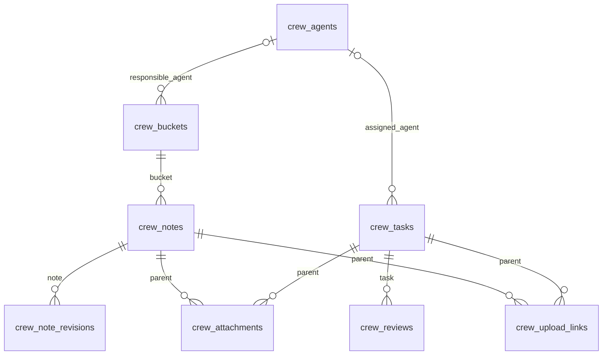

# Crew data model

Crew has one owner and one instance-wide model. There are no spaces or inherited
knowledge collections. Agents are role metadata, not accounts. Responsibilities
and task assignments are optional single-agent relations.

Notes and tasks also carry JSON arrays of note IDs. Events carry a parent record
ID as text, plus action, actor, reported_agent, reason and changes. These links are
validated by custom operations rather than generic record writes. Every Crew
record has revision and timestamps. Notes have immutable snapshots; events are
append-only. Agents, buckets, notes and tasks archive without purging history.

Attachments carry `parent_kind` (task or note) and the parent ID as text, a
protected single file (20 MiB, thumbs 1600x0 and 320x0, never exported), display
name, media type, verified-image flag and dimensions, size, server-computed
SHA-256, position, attribution and archive state. Their bytes are immutable and
never purged. Upload links store only a token SHA-256 with parent, expiry,
maximum files, usage and revocation. `crew_settings` is a singleton holding
`storage_limit_bytes` (default 5 GiB). Reviews snapshot the task's active
attachments as `[{id, sha256}]`. See [Attachments](crew.md#attachments).

Responsibility does not enforce write isolation. Work clients have the reader's
operations except webhook credential entry and upload-link creation; review decisions, archival and
deactivation follow the owner's authorization rules. See [Crew contract](crew.md).
