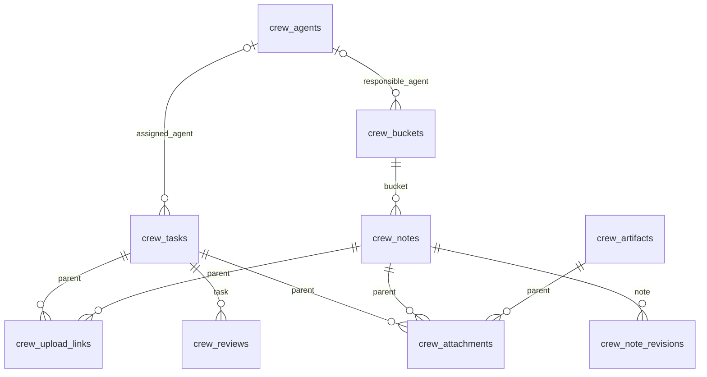

# Crew data model

Crew has one owner and one instance-wide model. There are no spaces or inherited
knowledge collections. Agents are role metadata, not accounts. Responsibilities
and task assignments are optional single-agent relations.

Notes and tasks also carry JSON arrays of note IDs. Events carry a parent record
ID as text, plus action, actor, reported_agent, reason and changes. These links are
validated by custom operations rather than generic record writes. Every Crew
record has revision and timestamps. Notes have immutable snapshots; events are
append-only. Agents, buckets, notes and tasks archive without purging history.

Agents have a `kind`: `bot` (default; Grok bots woken by webhook), `external`
(coder sessions the owner starts by hand) or `human`. Only bots are woken. Tasks
carry an advisory claim: `claimed_by` (reported session name, attribution only),
`claimed_at` (start) and `claim_until` (ISO UTC lease end), empty without a claim.
Responses add a
derived `claim_state`. See [project coder agents](crew.md#project-coder-agents).
Task `status` is `todo`, `in_progress`, `needs_review`, `done` or `wont_do`
(terminal like done). Tasks also carry `release` (the shipping release, at most 32
characters), `review_mode` (empty, `crew` or `in_session`), `approved_by` (reported
name, attribution only) and the server-set `approved_at`; see
[releases and in-session approval](crew.md#project-coder-agents).

Artifacts (0.21.0) are pages shared by link. The draft is `title`, `body`
(Markdown) and `sources` (note and task IDs, shown only in Crew); `status` is
`draft`, `published` or `revoked`. Publishing copies `published_title`,
`published_body` and `published_files` (ordered image attachment IDs; attachments
are immutable, so the snapshot never changes) with `published_at`, `published_by`
and `published_revision`. `token` is a hidden field (32 random base62 characters,
cleared on revoke; never in crew_read, SQL or MCP). `view_count` and
`last_viewed_at` are updated by the public page outside the record revision. See
[Artifacts](crew.md#artifacts).

Attachments carry `parent_kind` (task, note or artifact) and the parent ID as text, a
protected single file (20 MiB, thumbs 1600x0 and 320x0, never exported), display
name, media type, verified-image flag and dimensions, size, server-computed
SHA-256, position, attribution and archive state. Their bytes are immutable and
never purged. Upload links store only a token SHA-256 with parent, expiry,
maximum files, usage and revocation. `crew_settings` is a singleton holding
`storage_limit_bytes` (default 5 GiB). Reviews snapshot the task's active
attachments as `[{id, sha256}]`. Optional review `options` freeze keyed alternative
bodies; `option_decisions` records each approved/rejected choice. Tasks have
server-managed `held_since` for stable hold age on open tasks. See [Attachments](crew.md#attachments).

Responsibility does not enforce write isolation. Work clients have the reader's
operations except webhook credential entry, upload-link creation and publishing artifacts; review decisions, archival and
deactivation follow the owner's authorization rules. See [Crew contract](crew.md).
