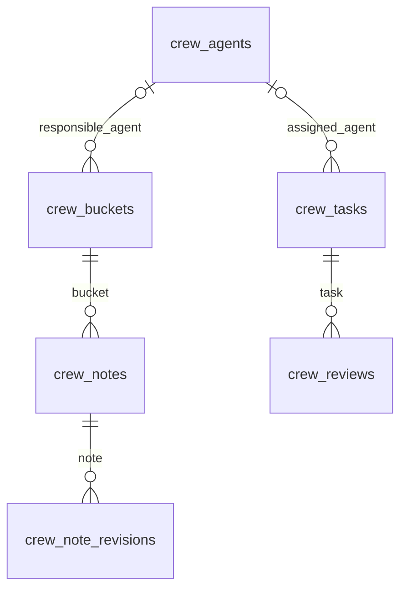

# Crew data model

Crew has one owner and one instance-wide model. There are no spaces or inherited
knowledge collections. Agents are role metadata, not accounts. Responsibilities
and task assignments are optional single-agent relations.

Notes and tasks also carry JSON arrays of note IDs. Events carry a parent record
ID as text, plus action, actor, reported_agent, reason and changes. These links are
validated by custom operations rather than generic record writes. Every Crew
record has revision and timestamps. Notes have immutable snapshots; events are
append-only. Agents, buckets, notes and tasks archive without purging history.

Responsibility does not enforce write isolation. Work clients have the reader's
operations except webhook credential entry; review decisions, archival and
deactivation follow the owner's authorization rules. See [Crew contract](crew.md).
