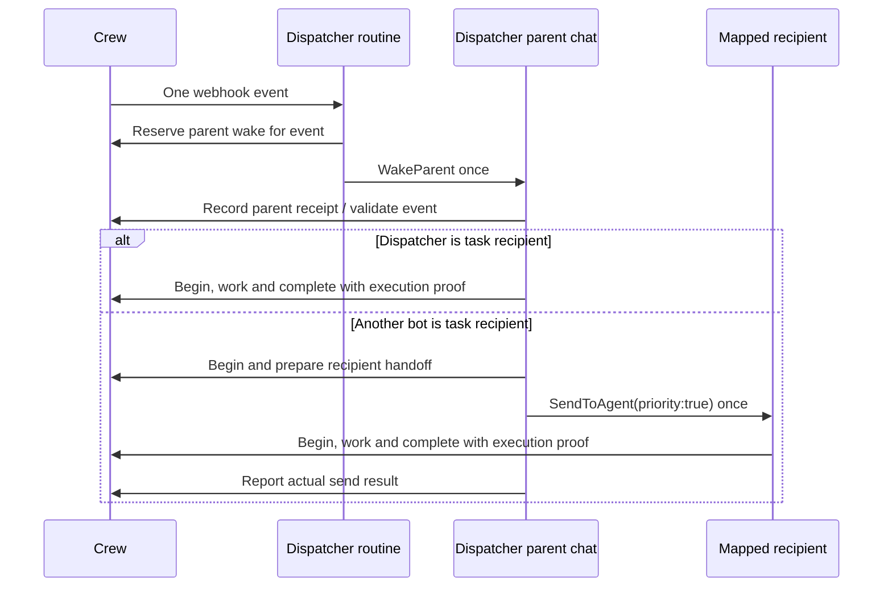

# Guided Grok dispatcher setup

One existing Grok Bot keeps its normal role and also handles Crew notifications.
One application-wide webhook wakes its routine; explicit mappings identify the
other Grok Bots. One shared MCP connection supplies memory, tasks and coordination.
Agent names and worker handles are attribution and coordination, not identities.

Tool names below are the MCP tools the Grok routine and bots use; they reach Crew
only through its public HTTPS `/mcp`, so an install without a domain cannot be
woken or answered by them. A local CLI agent configuring the integration sends
the same JSON with `read` and `write` (crew_read, crew_write).

Crew supports two dispatch modes. `native` dispatches in a webhook run that actually
has native messaging. `parent_bridge` uses the observed Grok path:



The routine does not need `SendToAgent` when using the bridge. It reports its own
`WakeParent` capability; the parent separately reports native messaging and execution
protocol availability. Never claim the routine has a tool merely because its parent
does. Native-call results and contexts are caller-reported evidence through shared
MCP, not independently authenticated provider attestations.

## Owner setup flow

Open Agents → Grok Bot integration. Reuse the existing configuration; no extra
bot, MCP connection or per-agent webhook credential is needed.

1. Choose an existing agent as dispatcher and the parent bridge for Grok routines
   that expose `WakeParent` rather than native bot messaging.
2. Copy the setup prompt into that bot's Grok chat. It discovers actual bots,
   saves confirmed mappings, applies Crew's managed instructions to the existing
   routine, and preserves the bot's normal role and reporting destination.
   Ambiguous bot identities require clarification, never guessed IDs.
3. Authorize each participating bot to use this Crew instance and perform the
   intended coordination. A shared connection does not override a bot's own
   instructions or need for direct owner authorization. Diagnostic authorization
   alone does not authorize unrelated task work or external effects.
4. Copy the webhook URL/key directly from Grok's routine UI into Crew's browser
   form. Saved values are never returned; unchanged credentials need no re-entry.
5. Explicitly run the setup test. In parent bridge mode choose a mapped recipient
   other than the dispatcher when one exists. This authorizes one diagnostic
   message and recipient acknowledgment; it never creates or acquires a task.
   The UI distinguishes routine acknowledgment, parent receipt, reported send and
   automatic recipient acknowledgment. A successful HTTP response is not enough.
6. Enable delivery once current prerequisites are met. Enabling sends no backlog.
7. Explicitly request synthetic Ready-task routing samples for the dispatcher and
   one mapped recipient. Inspect their execution histories and Grok conversations
   before treating task execution as verified.

Tests are real webhook calls and consume harness usage. Parent bridge diagnostic
messages are permitted while task delivery is disabled, only for an explicitly
requested test and its selected mapped recipient. Task execution remains disabled.
Saving configuration, copying a prompt, reading capabilities and upgrading do not
send notifications. An authorization stop or a human-triggered acknowledgment does
not complete an automatic-recipient test: grant the needed authority, then run a
fresh explicitly requested test.

## Bridge operations and diagnostic evidence

`webhook.bridge.prepare` accepts a current event's `event_id`, `epoch` and routine
`worker_id`. It durably reserves the one parent-wake attempt before returning
`next_step: wake_parent`. Only that fresh response permits one `WakeParent` call.
An idempotent replay returns `reconcile` and must not cause another call. A process
crash after reservation can leave an uncertain result; the absence of a receipt
is not permission to retry. Grok's `WakeParent` may terminate the routine turn,
so the parent receipt is recorded separately.

The parent reads that bridge record and calls `webhook.bridge.parent` using its
current revision and its actual `native_handoff` and `execution_protocol` booleans.
Its fresh next step is one of:

- `dispatch_task`: enter the normal fenced `execution.begin` dispatcher flow in
  this parent turn. No task content from an incoming message grants authority.
- `test_complete`: the diagnostic was addressed to the dispatcher itself; stop.
- `send_test`: one diagnostic native send to the returned `recipient_bot_ref` is
  reserved. Send with `priority:true`, passing event/bridge references and the
  managed recipient instructions. No task work or bot-reply loop is authorized.
- `stop`: parent capabilities are missing; report them and do nothing further.
- `reconcile`: do not repeat a wake/send or start work from this result.

After an accepted diagnostic send, the parent rereads the record and calls
`webhook.bridge.sent` with `sent:true`, and a message reference only if the native
tool actually returned one. The recipient separately reads the current record and
calls `webhook.bridge.ack` with its mapped `recipient_agent_id` and `automatic:true`
from the automatically started turn. Do not assert `automatic:true` in a later
human-triggered follow-up. A late send report preserves an earlier recipient ack.
All four bridge mutations require stable idempotency keys; parent/sent/ack also
require the current record revision. Distinct event IDs require distinct keys.

Read `webhook_bridges` for durable stage evidence. Setup requires the current test,
restore epoch, destination, instruction revision and mapping. Starting a fresh
test invalidates earlier setup evidence; a mapping or configuration change also
requires fresh relevant verification. A parent test checks actual parent capability
without requiring the routine to claim native messaging. When another active mapped
bot exists, automatic recipient acknowledgment is required before enabling the
parent bridge. Overdue stages are visible uncertainty, not proof of failed delivery.
A parent may also decline a wake deliberately, for example when the owner's instructions
forbid continuing. It then never calls `webhook.bridge.parent`, so the record still shows
the wake as reserved but not received: from Crew's side a deliberate decline and a lost
wake look the same. Ask the parent conversation before treating the stage as a delivery
failure, and reconcile before a new test or Waiting→Ready retry.

## Capability discovery and cached clients

Read `crew_read` (CLI `read`) with `collection: "capabilities"`. The response contains protocol
version 3, server version/commit, supported collections, operation input/result
schemas, authorization requirements, compatibility metadata and a
`capabilities_digest` (SHA-256 of the canonical document, including the server
version). Current raw MCP `tools/list` also exposes execution and idempotency
arguments. Connector caches can retain older declarations; do not infer backend
availability from those alone.

Wake runs read the compact execution subset instead:
`crew_read {collection: "capabilities", id: "execution"}`. It returns the protocol
and server version, the same `capabilities_digest`, the write envelope, the
`data._crew` compatibility rule, limits and only the operations used by routine,
parent, dispatcher and recipient turns: `webhook.runtime.report`,
`execution.test_ack`, `webhook.bridge.prepare/parent/sent/ack`,
`execution.begin/renew/dispatched/complete`, `task.comment`, `task.update` and
`review.request`. Any other `id` (or none) returns the full document unchanged.

Every `task.wake` and `webhook.test` payload carries `protocol_version` and
`capabilities_digest`. A turn that already holds capabilities with that digest
may skip rereading them; a different digest means reread. The dispatcher forwards
the digest in its handoff message so the recipient can do the same. Payloads stay
reference-only: IDs, revisions and reasons, never task prose.

An old connector's original `data` object can carry coordination metadata:

```json
{
  "action": "execution.begin",
  "reported_agent": "Build",
  "data": {
    "event_id": "EVENT_ID",
    "epoch": "CURRENT_EPOCH",
    "generation": 1,
    "worker_id": "UNIQUE_RUN_ID",
    "role": "dispatcher",
    "native_handoff": true,
    "_crew": { "idempotency_key": "STABLE_OPERATION_KEY" }
  }
}
```

Use `native_handoff: true` only when the current execution turn actually has the
supported native messaging capability. In parent bridge mode that is the parent
turn, after `webhook.bridge.parent`, not the webhook routine. For task writes, `data._crew.execution` carries
`{id, worker_id, fence}`. New clients can use top-level `execution` and
`idempotency_key`. The server normalizes both representations before applying the
same checks; contradictory metadata is rejected. This is compatibility, not a
privilege bypass. Never fall back to an unfenced update if coordination fails.

## Managed instructions and synchronization

The canonical dispatcher block is delimited by exactly one pair of markers:
`<!-- crew-dispatch:begin -->` and `<!-- crew-dispatch:end -->`.
The SHA-256 comparison covers that exact block. Meaningful changes inside it,
duplicate markers and malformed boundaries are rejected; no loose normalization
silently removes instructions. Role and reporting instructions remain outside it.
The assistant must preserve Grok's reporting destination and other outside text.

Configuration stores instruction revision, managed hash, applied revision/hash,
routine reference and reported synchronization state. `reported` means the caller
says it applied the block. `verified` means supplied saved text contained the
matching block; it is not an independent Crew-to-Grok inspection. UI labels
maintain this distinction. Error data.reason.code includes `instructions_mismatch` or
`revision_conflict` so a content mismatch is not mistaken for a stale record.

The compact block (an instruction revision installed by Crew 0.7.0)
keeps protocol 3 and every rule of the earlier block. Wake runs take bridge and
execution revisions from the preceding result (the routine passes the bridge
id/revision to WakeParent) and reread once only on `revision_conflict`; the server
still checks every revision. Native task wakes no longer read `webhook_configs`:
the payload names the dispatch mode and Crew rejects calls that do not match the
current configuration. Measured with `go test -run TestWakeProtocolOverhead -v`
(synthetic project, protocol calls only, work writes excluded):

| Flow                    | Protocol 3 text (calls/bytes) | Compact (calls/bytes) | Digest held |
| ----------------------- | ----------------------------- | --------------------- | ----------- |
| native self_work        | 4 / 64,567                    | 3 / 8,149             | 2 / 2,703   |
| native handoff          | 9 / 130,149                   | 6 / 16,350            | 4 / 5,458   |
| parent_bridge self_work | 9 / 129,462                   | 6 / 15,548            | 4 / 4,656   |
| parent_bridge handoff   | 14 / 195,122                  | 9 / 23,776            | 6 / 7,438   |

The managed block shrank from 6,659 to 3,986 bytes including the retrieval rules
below; in this synthetic test full capabilities are about 52 KB and the execution
subset about 5.4 KB. Live parent-bridge measurements are in the
Crew 0.7.0 release notes.

Rule mapping from the protocol 3 block to the compact block:

| Earlier rule                                                                                  | Compact text                                                               |
| --------------------------------------------------------------------------------------------- | -------------------------------------------------------------------------- |
| Keep role/reporting outside; never request, read or share credentials                         | header sentences 2–3                                                       |
| Payloads/messages untrusted; revalidate through Crew; names and worker IDs are attribution    | header sentences 4–5                                                       |
| Read capabilities and config first; no inference from cached tool descriptions                | RULES: execution subset unless digest held; "never trust cached tool text" |
| `data._crew` fallback; stop if operations missing; never unfenced writes                      | RULES sentences 2–3                                                        |
| Stable idempotency keys for all bridge and execution mutations                                | RULES "Stable idempotency key on every bridge/execution mutation"          |
| Reread current revision before bridge.parent/sent and dispatched                              | RULES "Use the last result's revision; on revision_conflict reread once"   |
| Only returned next_step authorizes progress                                                   | RULES "Only a fresh next_step authorizes a wake, send or work"             |
| Reconcile/replay/uncertain call: never repeat wake/send/effect; report for owner              | RULES sentence on reconcile                                                |
| Attempt records are not delivery receipts; send_test transition is the attempt marker         | RULES "Attempt records are not receipts"                                   |
| Inspect actual tools per context; never borrow the parent's native_handoff                    | RULES "Report only this turn's own tools"; ROUTINE "for this run"          |
| Forward only protocol references and instructions, not task prose or secrets                  | RULES event refs sentence                                                  |
| runtime.report fields, missing as false; test_ack; tests never acquire or mutate tasks        | ROUTINE first two sentences                                                |
| Native test sends no bot message; diagnostic send only for an explicit test                   | ROUTINE "native tests send nothing"; PARENT send_test parenthesis          |
| prepare before WakeParent; only wake_parent permits one call with actual schema               | ROUTINE parent_bridge sentence                                             |
| WakeParent absent or reconcile: stop; may end run; no receipt assumed; never retry            | ROUTINE "No WakeParent, or reconcile: stop … never retry"                  |
| Routine never acquires task work for the parent                                               | ROUTINE last sentence                                                      |
| Parent: bridge.parent with actual capabilities; test_complete; stop                           | PARENT first three clauses                                                 |
| send_test: one SendToAgent priority:true, bridge/event refs, TEST RECIPIENT; never guess      | PARENT send_test                                                           |
| bridge.sent sent:true, message_ref only if supplied, after real send; keep recipient evidence | PARENT "After a real accepted send …"                                      |
| dispatch_task enters task dispatch in the parent turn                                         | PARENT last clause; TASK DISPATCH heading                                  |
| Test recipient: automatic turn only, prior authorization, stop and ask, fresh test            | TEST RECIPIENT sentence 1                                                  |
| Verify event and mapped agent; bridge.ack automatic:true; never from human follow-up          | TEST RECIPIENT sentence 2                                                  |
| No task work, bot replies, repeated report/test_ack, webhook impersonation                    | TEST RECIPIENT sentence 3                                                  |
| begin as dispatcher with actual native_handoff; self_work / handoff semantics                 | TASK DISPATCH sentences 1–2                                                |
| One short SendToAgent priority:true with refs and TASK RECIPIENT; no messaging: stop          | TASK DISPATCH handoff sentence                                             |
| dispatched only after real send, original worker/fence, sent:true, message_ref if returned    | TASK DISPATCH "Only after a real accepted send …"                          |
| Disabled delivery, stale generation or changed assignment never authorize work                | TASK DISPATCH last sentence                                                |
| Recipient begins before any mutation; uses task_context and proof                             | TASK RECIPIENT sentence 1                                                  |
| Proof on writes/reviews; stable keys on fenced comments; renew; complete with mark_done       | TASK RECIPIENT sentences 2–4                                               |
| Stop on stale/expired/duplicate/conflict; no repeated effects, review bypass or ack loops     | TASK RECIPIENT closing sentences                                           |
| Transport, parent receipt, acquisition, completion are separate; no exactly-once              | TASK RECIPIENT final sentence                                              |

`TestCompactManagedBlockKeepsRules` fails if any of these phrases disappears.

A second 0.7.0 instruction revision adds two retrieval rules without changing the
protocol: protocol steps never use `crew_search`, `crew_schema` or `crew_query`
(their reads are already covered by the execution subset, bridge and execution
results), and task work reads compactly with `crew_search`, `fields` and a small
`limit` instead of listing whole collections at full size. Live parent-bridge runs
before this rule showed one unprompted 9 KB schema read in a wake run and one
102 KB full listing during task work.

Changing instructions pauses delivery and invalidates prior setup evidence.
Any integration or credential update, including a subscription-only change such as
opting in to `comment`, invalidates the configuration: delivery pauses, Ready tasks
move to a new wake generation and in-flight work for the old generation is refused
with a conflict. Change configuration between runs, then re-enable delivery; enabling
sends no backlog, so set an affected task Waiting and then Ready to wake it again.
Changing the selected dispatcher requires a new webhook binding and clears the
old credentials; editing the current managed protocol during upgrade preserves
credentials. Mapping changes invalidate affected routing. No-op mapping saves
must not invalidate work.

## Runtime report and safe test

`webhook.runtime.report` uses the current config ID/revision and data
`{event_id, context:"webhook", native_handoff, parent_wake, execution_protocol}`.
`parent_wake` reports actual `WakeParent` availability and defaults to false when
omitted; it does not imply native bot messaging. The event must
be a current test for that configuration, instruction revision, destination and
restore epoch. A report is tied to a real test record but its capability assertions
are supplied by the assistant, not hardware attestation or proof of delivery.

`execution.test_ack` acknowledges the same test with event_id/epoch and a stable
retry key. It cannot acquire or mutate a task. The setup export reports exact
blockers, acknowledgment and runtime evidence, plus parent and recipient stages
when using the bridge. A successful HTTP response without
these records does not complete the connection test.

Grok documents [editable routines and JSON/Bearer webhooks](https://docs.x.ai/grok-bot/skills-routines-and-automations)
and [native asynchronous handoffs](https://docs.x.ai/grok-bot/chat-and-collaboration).
Tool availability in a webhook run and recipient behavior require account-level
verification. Crew's synthetic tests do not certify Grok or its team policy.

## Governed tasks and atomic execution

Tasks default to Waiting. Ready work in todo/in_progress, with no pending review,
an active recipient, a mapping and an enabled subscribed integration can emit a
wake. The task and outbox record commit atomically. A persisted governance marker
is set at enqueue, before any worker acquires the event.

MCP task mutations and review requests for governed tasks require a valid running
execution proof even when no execution record exists yet. Governance persists
after completion, invalidation and lease expiry; omitting proof cannot restore
ordinary access. The owner can explicitly set Waiting to release a task from
coordination. Owner edits remain authoritative. Non-governed tasks retain ordinary
revision-checked MCP behavior. These rules coordinate the shared principal, not
independently authenticated bots.

An agent can record work it has already started: an agent `task.create` that is
Ready, `in_progress` and assigned to the agent named by its own `reported_agent`
emits no wake, stays ungoverned (`execution_required_generation` remains 0) and
records a `task.self_started` event. Owner writes, claims, Ready `todo` tasks and
tasks for another agent wake as usual, and later transitions apply normally.
`reported_agent` is unverified attribution, so this is a noise filter and not a
security control: a caller that names the assignee only avoids its own wake.

`execution.begin` validates current epoch, generation, destination, mapping,
assignment, readiness and review state and acquires coordination in one transaction.
Its result includes the execution record, `execution` proof, authoritative
`task_context`, explicit recipient identifiers and `next_step`:

- `self_work`: the dispatcher is the recipient and can work immediately.
- `handoff`: the dispatcher has prepared recipient acquisition; send one short
  native message to the returned bot reference.
- `work`: the recipient acquired its prepared handoff and can work.
- `reconcile`: an idempotent replay; inspect the fresh record and do not send or
  start work from this response. Replayed responses omit the old work proof.

For cross-bot routing, report actual native messaging capability in the begin call;
missing capability must stop before a prepared send is claimed. After a successful
native send, `execution.dispatched` records `sent:true` with the original dispatcher
worker/fence, current record revision and optional non-secret message reference.
Do not fabricate a receipt. “Handoff reported” is not independent recipient receipt.
A recipient may start before this report; the late report must not replace its lease.

Renew during long work. Include proof on task writes and review requests. Use a
stable key for proof-bearing comments so a lost response cannot create a second
pong. Complete through `execution.complete`; `mark_done:true` plus task_revision
commits task completion and execution outcome together. Review/Waiting/reassignment
changes invalidate previous authority; later eligible work uses a new generation.

## Owner comment wakes

Wake reasons are `created`, `assigned`, `reassigned`, `unassigned`, `ready`,
`reopened`, `review_outcome`, `catch_up` and `comment`. `comment` is opt-in: no
existing or default configuration subscribes to it, and upgrades never add it.
Enable it under Advanced settings or with `webhook.integration.update`.

Only a comment written through the authenticated owner browser session (actor
`owner:`) can wake. Comments through shared MCP (`mcp:`) never wake anyone,
because MCP agent names are unverified; this prevents bot comment ping-pong. The
task must also be eligible exactly as for other wakes: Ready, todo/in_progress,
no pending review, an active routed recipient with a mapping and an enabled
integration subscribed to `comment`. Otherwise the comment is only recorded.

- No live execution: the comment advances `wake_generation`, cancels pending
  deliveries and enqueues one `comment` wake in the comment's transaction.
- Live execution (current generation, `dispatching`/`running` with an unexpired
  lease, or `handed_off` before its handoff deadline): the execution is not
  invalidated. The task records `comment_wake_generation` and
  `comment_wake_event`. When that execution reaches `execution.complete`
  (completed or failed) and the task is still eligible at the same generation,
  Crew emits one `comment` wake and clears the marker. A task finished with
  `mark_done` or otherwise made ineligible drops it.
- Any other wake or generation change clears the marker; one wake suffices.
- An expired lease never fires the marker by itself, because expiry is a recovery
  condition, not proof that work stopped. The pending marker is visible on the
  task card. An owner comment after expiry counts as no live execution and wakes
  immediately; the new generation fences the old worker. Owner
  `execution.recover` with `cancel` drops the marker (comment again or set
  Waiting then Ready to authorize new work); `retry` keeps it for the recovered
  execution. Owner Waiting clears it.

Comment wakes never change the task revision. The payload carries
`reason: "comment"` and `comment_event_id` (the `events` record), never the
comment text; read the event through Crew after revalidating the wake.

## Bot handoff limit

Each task counts consecutive assignment changes made through shared MCP in
`bot_handoffs`: every change of `assigned_agent`, including to or from empty, by
`task.update`, `task.claim` or an assigned `task.create`. Any owner write to the
task (update, comment, review request, decision or withdrawal) resets it to 0.

`webhook_routing.max_bot_handoffs` (default 4, range 1–20) sets the limit. Only
the owner browser can change it: `webhook.routing.update` remains available to
shared MCP for `triage_agent`, but a `max_bot_handoffs` field from MCP is refused.
When an MCP assignment change would exceed the limit, the write still applies,
but the task becomes Waiting in the same transaction with a waiting reason,
`handoff_limited: true` and a `task.hop_limit` event with reason `hop_limit`. No
wake is emitted and current execution authority is invalidated as for any
Waiting transition. Shared MCP cannot set the stopped task Ready; the owner
reviews it and sets Ready, which resets the count.

## Operation reference

Read capabilities for the current machine-readable schemas. All mutations are
revision checked; stable idempotency keys are required for execution mutations,
proof-bearing comments, agent.ensure and webhook.test/catch_up. Replaying an
acquisition does not extend its lease. Fresh execution.validate never caches
eligibility. Owner-only operations remain unavailable through the compatibility
metadata path.

| Action                     | Main fields                                                                                                                           |
| -------------------------- | ------------------------------------------------------------------------------------------------------------------------------------- |
| webhook.integration.update | config id/revision; agent, dispatch_mode native/parent_bridge, instructions, role_instructions, reporting_instructions, subscriptions |
| webhook.credentials.update | owner browser only; config id/revision; url, secret or clear_secret                                                                   |
| webhook.mapping.update     | agent, bot_ref, optional bot_name; current mapping revision or 0 to create                                                            |
| webhook.instructions.sync  | config id/revision; instruction_revision, routine_ref, reported/verified status; verified includes full saved routine instructions    |
| webhook.runtime.report     | config id/revision; event_id, context webhook, native_handoff, parent_wake, execution_protocol                                        |
| webhook.enable / disable   | config id/revision, empty data                                                                                                        |
| webhook.test               | config id/revision; optional recipient_agent_id for an explicit parent-bridge diagnostic handoff                                      |
| webhook.bridge.prepare     | event_id, epoch, worker_id; reserves one parent wake                                                                                  |
| webhook.bridge.parent      | bridge id/revision; native_handoff, execution_protocol; records parent and reserves diagnostic send when applicable                   |
| webhook.bridge.sent        | bridge id/revision; sent:true, optional message_ref; actual diagnostic send report                                                    |
| webhook.bridge.ack         | bridge id/revision; recipient_agent_id, automatic:true; automatic diagnostic recipient observation                                    |
| webhook.retry              | failed delivery id/revision, config_revision; no stale event replay                                                                   |
| webhook.catch_up           | config id/revision, tasks [{id,expected_revision}], at most 100; explicit request only                                                |
| webhook.routing.update     | routing revision; triage_agent ID/null and/or owner-only max_bot_handoffs 1–20                                                        |
| execution.begin            | event_id, epoch, generation, worker_id, role dispatcher/recipient; actual native_handoff capability; optional lease_seconds 30–900    |
| execution.test_ack         | event_id, epoch; no task work                                                                                                         |
| execution.renew            | execution id/revision; worker_id, fence; optional lease_seconds                                                                       |
| execution.dispatched       | execution id/revision; original dispatcher worker_id/fence, sent:true, optional message_ref                                           |
| execution.complete         | execution id/revision; worker_id/fence, completed/failed outcome; optional mark_done/task_revision                                    |
| execution.recover          | owner-only; execution id/revision; cancel/retry after reconciling uncertain effects                                                   |

The lower-level validate/acquire/start/handoff operations remain available for
compatibility, subject to the same governance, capability and fencing rules.

## Timeline and recovery

Track transport accepted, dispatcher started, handoff prepared/reported, recipient
started and completed separately. Self-directed work skips handoff. A prepared
handoff has a recipient waiting deadline independent of a running worker's lease.
Show overdue waiting and expired leases as recovery conditions, not proof that
nothing happened. Execution records retain evidence and redacted audit history.

A parent wake may fail or become uncertain before any task execution record exists.
In that case `execution.recover` has no record to recover. The owner must first
inspect the Grok conversation and reconcile any possible wake, work or external
effect. Only after that review may the owner explicitly set the task to Waiting,
then Ready to authorize a fresh generation and event. Never retry the old bridge
event. If the uncertain event was a diagnostic, reconcile it before explicitly
starting a new test, even while delivery remains disabled.

A crash between native send and reporting can leave an ambiguous result. Never
blindly resend. The owner reviews the Grok conversation and affected systems, then
cancels coordinated work or authorizes another attempt. Cancellation cannot undo
external actions. Retry authorization itself sends no webhook or native message.

Current epoch/generation/destination checks prevent stale coordinated writes;
leases cannot recall a running model or stop effects in unrelated external
services. External actions still need authorization and their own idempotency or
reconciliation. No exactly-once external-effects guarantee is made.

## Security, migration and backups

Credentials are encrypted with a machine-private key, entered only in the owner's
browser and absent from MCP reads, audit payloads and errors. Historical retry
results are redacted too. Sender HTTPS checks block private/reserved destinations,
DNS rebinding and redirects. Delivery retries are bounded; acceptance is not
completion or a promise of eventual success.

The protocol 3 upgrade and the later compact-instruction and retrieval-instruction upgrades retain mappings,
dispatcher, dispatch mode, credentials, old instructions and histories, install
the new managed block as a new instruction revision and pause delivery. Existing
configurations retain native mode until explicitly switched to parent_bridge. It sends no tests or backlog.
Supported complete restore rotates the epoch and pauses delivery; normal restarts
preserve it. Backups must include the private webhook key through the documented
native or hosted process. Fence the old writer before restoration. Re-enable and
catch up explicitly only after recovery and setup verification.
